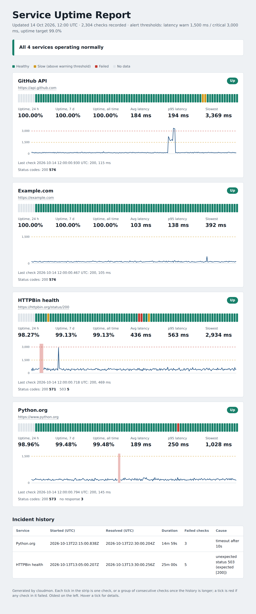
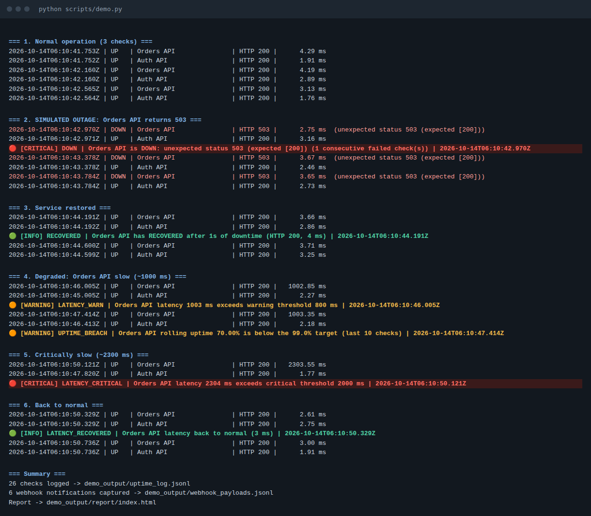
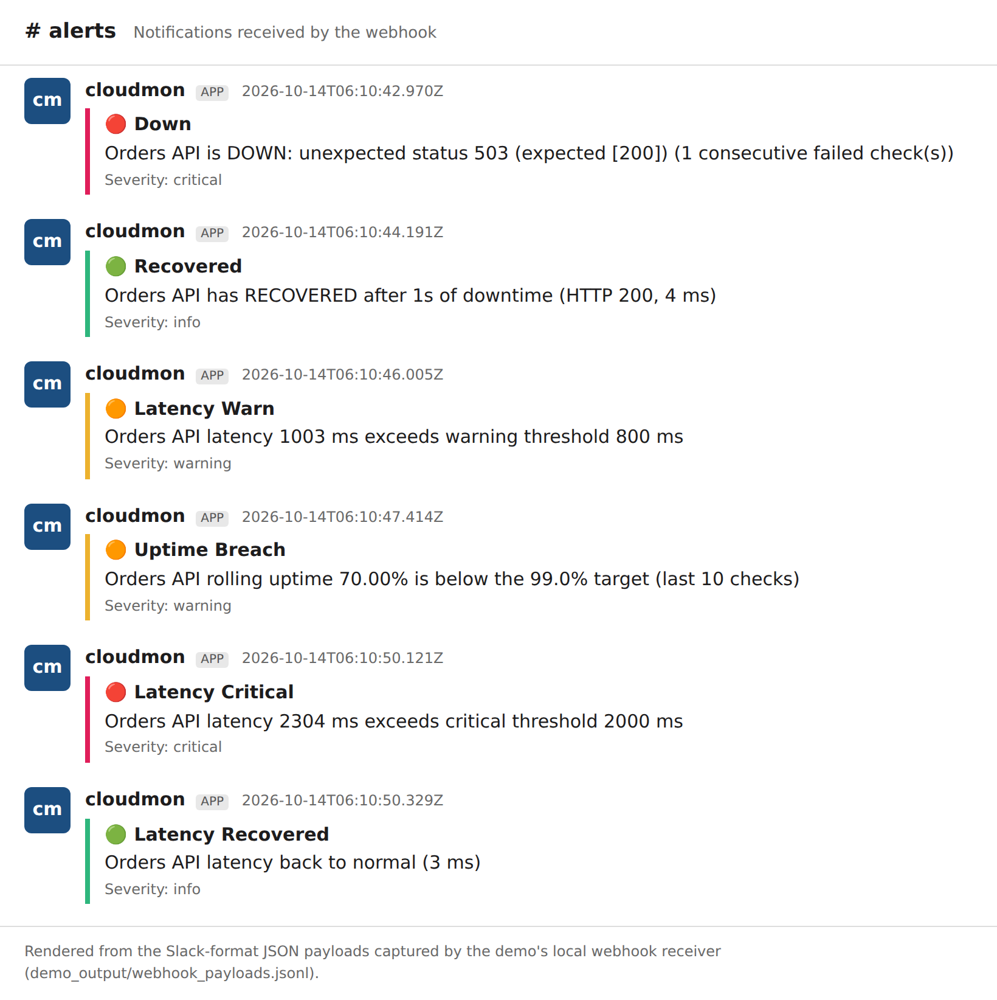

# Cloudmon: telemetry & automated alerting

A small uptime monitor that runs on **free infrastructure** (GitHub Actions cron, or any local cron/laptop).
It pings your endpoints, records **latency in milliseconds, HTTP status codes and uptime %**, sends an
**alert the moment a threshold is breached** (console, Slack/Discord/Teams webhook, or e-mail), and publishes a
**historical availability dashboard**.



| Requirement | Where it is implemented |
|---|---|
| Health-check script pinging endpoints at configured intervals | [`monitor.py`](monitor.py), [`cloudmon/checker.py`](cloudmon/checker.py); `--loop`/`--interval` locally, [cron workflow](.github/workflows/monitor.yml) in CI |
| Latency (ms), status codes, uptime % | One JSON line per check in `logs/uptime_log.jsonl`; aggregated by [`cloudmon/report.py`](cloudmon/report.py) |
| Alert on threshold breach | [`cloudmon/evaluator.py`](cloudmon/evaluator.py) decides, [`cloudmon/alerts.py`](cloudmon/alerts.py) delivers |
| Uptime report / dashboard | `docs/index.html`, `docs/uptime_report.md`, `docs/uptime_log.csv` |
| Scheduled workflow YAML | [`.github/workflows/monitor.yml`](.github/workflows/monitor.yml) |
| Sample uptime logs | [`sample_logs/`](sample_logs) |
| Detects simulated downtime and alerts immediately | `scripts/demo.py`, `--simulate-down`, and an automated test (`test_end_to_end_simulated_downtime_triggers_alert_and_logs`) |

---

## Contents
1. [Quick start](#quick-start)
2. [Configuration and alert thresholds](#configuration-and-alert-thresholds)
3. [Alerting](#alerting) · [Incident notification screenshots](#incident-notification-screenshots)
4. [Run it free on GitHub Actions](#run-it-free-on-github-actions)
5. [Run it locally (cron)](#run-it-locally-cron)
6. [Log format and sample logs](#log-format-and-sample-logs)
7. [Reports](#reports)
8. [Testing and outage drills](#testing-and-outage-drills)
9. [Project layout](#project-layout) · [Design notes and limits](#design-notes-and-limits)

---

## Quick start

Requires Python 3.10+ (developed on 3.12). Two dependencies: `requests` and `PyYAML`.

```bash
python -m venv .venv && source .venv/bin/activate     # Windows: .venv\Scripts\activate
pip install -r requirements.txt

python monitor.py                  # one round of checks, alerts, report refresh
python monitor.py --loop           # keep going every interval_seconds (Ctrl+C to stop)
python monitor.py --count 5 --interval 10   # 5 rounds, 10 s apart
python monitor.py --report-only    # rebuild docs/ from the existing log
python monitor.py --help
```

Try the whole thing with **no internet, accounts or secrets**; it starts two local services and a local webhook
receiver, breaks one on purpose and shows the alerts:

```bash
python scripts/demo.py
```

Console output of that drill (real output, saved in [`docs/demo_transcript.txt`](docs/demo_transcript.txt)):



Exit codes: `0` success · `1` configuration error · `2` a critical alert fired (only with `--fail-on-alert`).

---

## Configuration and alert thresholds

Everything lives in [`config.yaml`](config.yaml). All keys except `endpoints` are optional.

### Thresholds (`thresholds:`)

| Key | Default | Meaning |
|---|---|---|
| `latency_warn_ms` | `1500` | **WARNING** when a *successful* response takes at least this long |
| `latency_critical_ms` | `3000` | **CRITICAL** when a successful response takes at least this long |
| `consecutive_failures` | `1` | Failed checks in a row before a **DOWN** alert. `1` = alert immediately. Use `2`-`3` to ignore one-off blips |
| `uptime_min_percent` | `99.0` | **WARNING** when rolling uptime falls below this |
| `uptime_window_checks` | `100` | Rolling window used for that uptime figure (last N checks per endpoint) |
| `uptime_min_samples` | `10` | Do not evaluate uptime until this many checks exist (avoids "1 failure out of 1 = 0%") |
| `repeat_alert_minutes` | `0` | Send a **STILL_DOWN** reminder every N minutes during an outage (`0` = off) |

A check counts as a **failure** when the request errors (DNS, refused, TLS, timeout), the status code is not in
`expected_status`, or the optional `body_contains` text is missing. Slow-but-successful responses are *not* failures;
they raise latency alerts instead.

### Alert types (edge-triggered)

Alerts fire when a condition **starts or ends**, so a 3-hour outage sends one DOWN and one RECOVERED, not 36 messages.

| Type | Severity | Fires when |
|---|---|---|
| `DOWN` | critical | `consecutive_failures` failed checks in a row |
| `STILL_DOWN` | critical | Outage continues and `repeat_alert_minutes` has elapsed |
| `RECOVERED` | info | First healthy check after an outage; includes downtime duration |
| `LATENCY_WARN` | warning | Latency crosses `latency_warn_ms` |
| `LATENCY_CRITICAL` | critical | Latency crosses `latency_critical_ms` |
| `LATENCY_RECOVERED` | info | Latency returns below the warning threshold |
| `UPTIME_BREACH` / `UPTIME_RECOVERED` | warning / info | Rolling uptime drops below / returns above `uptime_min_percent` |

State between runs (so CI knows an outage is already reported) is stored in `logs/state.json`.

### Endpoints (`endpoints:`)

```yaml
endpoints:
  - name: Example.com            # unique label used in logs and alerts
    url: https://example.com
    method: GET                  # default GET
    expected_status: [200]       # default [200]; e.g. [200, 301] if you do not follow redirects
    body_contains: Example Domain  # optional content check
    timeout_seconds: 15          # optional per-endpoint override
    headers: { Authorization: "Bearer ..." }   # optional; use only non-secret values in a public repo
```

> **Public repo warning:** `config.yaml` is committed. Never put tokens in it. Monitor public URLs, or keep the
> repository private.

---

## Alerting

Three channels, enabled in `alerts:` of `config.yaml`. Secrets are **only** read from environment variables
(GitHub Actions secrets in CI), never from the config file.

### 1. Console (always available)
Coloured warning on stderr. Inside GitHub Actions the same alert is also emitted as an `::error::` / `::warning::`
annotation so it appears on the workflow run page.

### 2. Webhook: Slack, Discord, Teams or generic JSON
```yaml
alerts:
  webhook:
    enabled: true
    url_env: WEBHOOK_URL     # environment variable holding the URL
    format: slack            # slack | discord | teams | generic
```
* **Slack:** create an *Incoming Webhook* app for a channel, copy the URL.
* **Discord:** channel settings → Integrations → Webhooks → copy URL, and set `format: discord`.
* Locally: `export WEBHOOK_URL="https://hooks.slack.com/services/..."`
* In GitHub: repo → *Settings → Secrets and variables → Actions → New repository secret* named `WEBHOOK_URL`.

Delivery is retried up to 3 times with backoff. A missing secret or an unreachable webhook is reported once on the
console and never crashes the monitor.

### 3. E-mail (SMTP)
```yaml
alerts:
  email:
    enabled: true
    use_ssl: false    # false = STARTTLS on 587, true = implicit TLS on 465
```
Environment variables / secrets: `SMTP_HOST`, `SMTP_PORT`, `SMTP_USER`, `SMTP_PASSWORD`, `EMAIL_FROM`, `EMAIL_TO`.
(For Gmail use an app password.)

### Bonus: GitHub's own failure e-mail
With `--fail-on-alert` the workflow run turns **red** when a critical alert fires. GitHub then sends its standard
failed-workflow notification to the person who last edited the workflow's cron schedule (configure under
*Settings → Notifications → Actions*). This works with zero secrets.

### Incident notification screenshots

Below is the sequence the demo produced: outage detected, recovery, latency warning, uptime SLO breach, critical
latency, latency recovered:



> **Honesty note on these images:** they were generated by [`scripts/make_screenshots.py`](scripts/make_screenshots.py)
> from the *actual* JSON payloads captured by the demo's local webhook receiver
> ([`sample_logs/demo_run_webhook_payloads.jsonl`](sample_logs/demo_run_webhook_payloads.jsonl)) and the real console
> transcript. The Slack-style framing is a rendering, not a capture from a real Slack workspace. Once you set a real
> `WEBHOOK_URL` and run the [outage drill](#manual-outage-drill-in-github), replace them with genuine screenshots of
> your own channel using the same file names.

---

## Run it free on GitHub Actions

1. **Create a repository** and push this project (`git init && git add . && git commit && git push`).
2. **Edit `config.yaml`:** set your endpoints and thresholds.
3. **Add secrets** (optional, for webhook/e-mail): *Settings → Secrets and variables → Actions*.
4. **Allow the workflow to push:** *Settings → Actions → General → Workflow permissions → Read and write permissions*
   (the workflow also declares `permissions: contents: write`).
5. **Enable the schedule:** the workflow [`monitor.yml`](.github/workflows/monitor.yml) runs on `cron: "*/5 * * * *"`.
   Run it once manually from the *Actions* tab (*Uptime Monitor → Run workflow*) to confirm.
6. **Publish the dashboard (optional):** *Settings → Pages → Deploy from branch → `main` / `/docs`*. The dashboard is
   then at `https://<user>.github.io/<repo>/`.

What each run does: checkout → install deps → run checks and alerts → append to `logs/uptime_log.jsonl` → rebuild
`docs/` → write the report into the run summary → commit changes back with `[skip ci]` → fail the run if a critical alert fired.
Runs are serialised with a `concurrency` group so two monitors never race on the log.

### Manual outage drill in GitHub
*Actions → Uptime Monitor → Run workflow → tick **simulate_outage***. Every endpoint is pointed at a dead port, a
real DOWN alert is delivered to your webhook/e-mail, and the run turns red. Simulated data goes to
`logs/simulated_log.jsonl` and **does not touch** your real uptime log, state, or dashboard.

### Free-tier realities
* Public repositories get free Actions minutes. For **private** repos, a 5-minute cadence uses roughly
  8,600 runs/month, which can exceed the free monthly allowance; lengthen the cron (e.g. `*/15`) if needed.
* GitHub cron is **best effort**: 5 minutes is the minimum and runs can start several minutes late under load, so
  treat latency of detection as "5-15 minutes", not seconds.
* GitHub disables scheduled workflows in repositories with no activity for 60 days. If checks stop, re-enable the
  workflow in the Actions tab.
* The checks originate from GitHub's data centres, so results show availability from there, not from your users.
* For second-level resolution, run `python monitor.py --loop --interval 30` on any always-on machine instead.

---

## Run it locally (cron)

```cron
# every minute; adjust paths. Alerts via webhook need the env var in the cron environment.
* * * * * cd /path/to/cloud-monitor && WEBHOOK_URL="https://..." /path/to/.venv/bin/python monitor.py >> logs/cron.out 2>&1
```
Or run `python monitor.py --loop` under `tmux`, `systemd` or Task Scheduler.

---

## Log format and sample logs

Each check is appended as one JSON line to `logs/uptime_log.jsonl` (the single source of truth; the CSV is derived):

```json
{"timestamp":"2026-10-13T13:05:00.207Z","name":"HTTPBin health","url":"https://httpbin.org/status/200","status_code":503,"latency_ms":88.87,"ok":false,"error":"unexpected status 503 (expected [200])","latency_level":"n/a"}
{"timestamp":"2026-10-13T13:30:00.256Z","name":"HTTPBin health","url":"https://httpbin.org/status/200","status_code":200,"latency_ms":399.99,"ok":true,"error":null,"latency_level":"ok"}
```

| Field | Notes |
|---|---|
| `timestamp` | UTC, ISO-8601, millisecond precision, written when the check completes |
| `latency_ms` | Float, always **milliseconds**, rounded to 0.01. Measured with a monotonic clock around the full request; includes the time spent before a timeout or connection failure |
| `status_code` | HTTP status, or `null` when there was no response |
| `ok` | `true` only if the request succeeded **and** matched `expected_status` / `body_contains` |
| `error` | Human-readable reason when `ok` is false |
| `latency_level` | `ok`, `warn` or `critical` against the latency thresholds (`n/a` for failed checks) |

Retention: lines older than `storage.retention_days` (30 by default) are pruned each run. Corrupt/partial lines are skipped when reading.

### Included samples ([`sample_logs/`](sample_logs))

| File | Contents |
|---|---|
| `uptime_log.jsonl` | **2,304 checks**: 4 services x 48 h at 5-minute intervals, including a 25-minute HTTP 503 outage, a 15-minute timeout outage and a latency degradation. **Synthetic**, generated deterministically by `scripts/generate_sample_logs.py` |
| `alerts.jsonl` | The 15 alerts the default thresholds produce when replayed over that data |
| `demo_run_log.jsonl` | **26 real checks** from `scripts/demo.py` against local services (outage, recovery, slowdown) |
| `demo_run_webhook_payloads.jsonl` | The 6 real webhook payloads sent during that demo |

The dashboard for the synthetic data is in [`sample_reports/`](sample_reports) (open `index.html`).

---

## Reports

Regenerated after every run (and by `--report-only`), written to `report.output_dir` (default `docs/`):

* **`index.html`**: self-contained dashboard (no external assets, works offline, dark mode aware): overall status banner,
  per-service availability strip, 24 h / 7 d / all-time uptime, average / p95 / max latency, latency chart with
  threshold lines, status-code counts, incident history.
* **`uptime_report.md`**: the same figures as Markdown (also shown on each workflow run's summary page).
* **`uptime_log.csv`**: full history for spreadsheets.

Uptime % = successful checks / total checks in the window. Incident duration = first failed check to first healthy
check (so its resolution is your check interval).

---

## Testing and outage drills

```bash
pip install pytest
python -m pytest -q          # 24 tests, ~4 s, no internet needed
```

The suite covers latency in ms, HTTP 503, connection refused, timeouts, content checks, every alert transition
(down, no-spam, recovery, latency, uptime SLO, reminders), webhook delivery against a local receiver, log corruption,
retention, config validation and report generation. The end-to-end test flips a local service
up → down → up and asserts the DOWN console alert is emitted on the *very first failing check* and the log records `[ok, fail, ok]`.

Manual drills:

```bash
python scripts/demo.py                                   # full scripted outage, self-contained
python monitor.py --simulate-down all --fail-on-alert    # point endpoints at a dead port (exit code 2)
python monitor.py --simulate-down "GitHub API"           # simulate one endpoint

python scripts/flaky_server.py --port 8099 &             # your own controllable service
curl "http://127.0.0.1:8099/control?mode=down"           # /health -> 503
curl "http://127.0.0.1:8099/control?mode=slow&delay_ms=2000"
curl "http://127.0.0.1:8099/control?mode=up"
```
Put `http://127.0.0.1:8099/health` in a scratch config to watch real alerts fire.

---

## Project layout

```
cloud-monitor/
├── monitor.py                    # CLI entry point
├── config.yaml                   # endpoints, thresholds, alert channels
├── cloudmon/
│   ├── config.py                 # load + validate config
│   ├── checker.py                # HTTP check, latency in ms
│   ├── evaluator.py              # threshold logic -> alert events (edge-triggered)
│   ├── alerts.py                 # console / webhook / e-mail delivery
│   ├── storage.py                # JSONL log, state file, retention
│   ├── report.py                 # stats, incidents, Markdown/CSV/HTML dashboard
│   └── simulator.py              # controllable local service for drills/tests
├── scripts/                      # demo.py, flaky_server.py, generate_sample_logs.py, make_screenshots.py
├── tests/                        # pytest suite
├── .github/workflows/
│   ├── monitor.yml               # scheduled monitor (cron */5) + manual outage drill
│   └── ci.yml                    # tests on push/PR
├── logs/                         # live log + state (committed by the workflow)
├── docs/                         # live dashboard/report (+ screenshots)
├── sample_logs/  sample_reports/ # included examples
└── requirements.txt
```

## Design notes and limits

* **Edge-triggered alerting** prevents alert storms; use `repeat_alert_minutes` if you want reminders.
* **State and history live in git** (`logs/`), which keeps everything free and auditable but means the repo grows;
  retention pruning bounds it, and the commit step uses `[skip ci]` to avoid loops.
* Checks within a round run concurrently; each endpoint has its own timeout, so one hung service cannot delay the rest.
* Latency is end-to-end request time (DNS + connect + TLS + response body) from wherever the monitor runs.
* Not included on purpose: multi-region probing, authentication flows, and TCP/ICMP checks. They are straightforward to
  add in `checker.py`.
